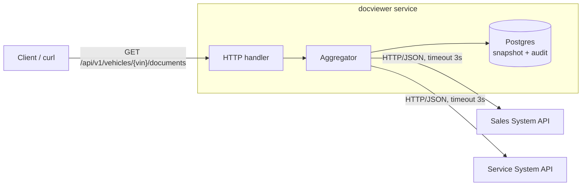

# Unified Document Viewer – System Design

## 1. Overview 
Build API to get doucment of vehicle base on VIN ( EX: Sales System and Service System)

## 2. Architecture Diagram

## 3. Components
- API handler
    Get VIN from HTTP request , call aggregator , return JSON and status code 
- VIN validator
    Make sure VIN send by request of client have correct format and not empty
- Aggregator
    Aggregates data for each system and normalizes it to 1 struct type 
    Check Cache, fan-out parallel request to two system
    Merges results and sets partial / stale flags
- Source client (Sales, Service)
    Implements a common Source interface
    Using for get data of each of system and mapping that data to Document
- Repository (Postgres)
    Read snapshot rows by VIN
    Insert data each system return when it success with fetched_at = now()
    Insert Log for each time call APIs
- Mock Sales / Mock Service
    Prepare Mock data for unit testing,standalone HTTP servers started by docker compose, standing in for the real external systems during demo

## 4. Data Flow
- Step 1:
    + Client send VIN to BE get information of that vehicle 
    + Validate VIN => If null => return msg : Please Input VIN
    + Check format of VIN => for case client send wrong type
    + Return status code 400
- Step 2:
    + Change format of VIN to uppercase
- Step 3:
    + If now() - fetched_at < 15 minutes => Read value of each system base on DB
    + If >= 15 minutes => call APIs
- Step 4:
    + Call the sources that are missing or expired in parallel, one goroutine per source, each with a 3s timeout
- Step 5:
    + If value return in each system. Update format of each data to one struct type ex:{"id": "S-1", "title": "Sales contract", "date": "...", "source": "sales"} when it have data .
    + If it null => keep empty list =>"partial": false. 
    + If it timeout or have error => "partial": true,append {source, reason} to errors.
    + If timeout or error and a snapshot row exists → use that snapshot's documents, stale: true
- Step 6:
    Append 2 data into 1 slice []Document sort by desc date
- Step 7
    + Insert each document base on source to table document_snapshots when it return success
    + Insert log for each time call API to two system with VIN , source ,status and fetched_at = now()
    Ex : INSERT ... ON CONFLICT (vin, source) DO UPDATE SET documents = ..., fetched_at = now()
- Step 8:
    Return data object with status 200
    Ex: {
            "vin": "...",
            "documents": [
                {"id": "S-1", "title": "Sales contract", "date": "...", "source": "sales"},
                {"id": "V-7", "title": "Oil change invoice", "date": "...", "source": "service"}
            ],
            "partial": false,
            "stale": false,
            "errors": []
        }

    

## 5. Design Decisions
- Partial Failure
    + Decision : Return with data when one of them success , have partial: true, errors with source & reason. Fall back to the stored snapshot if one exists
    + Alternative rejected : return wholes request with 502 when any source fails
    + Why : One of many services have error not all of that have error . We need return data get success and show error of what source have problem.
    +   | Source result | Snapshot in DB | Used data       | partial | stale |
        |---------------|----------------|-----------------|---------|-------|
        | OK            | any            | fresh data      | false   | false |
        | OK, empty     | any            | empty list      | false   | false |
        | Fail/timeout  | exists         | old snapshot    | true    | true  |
        | Fail/timeout  | none           | source missing  | true    | false |

- Cache in Postgres
    + Decision :  snapshot per (vin, source) in a Postgres table with fetched_at; TTL checked in code.
    + Alternative rejected : in-memory map; Redis.
    + Why : Data already saving . After restart it still there. Redis if expire data will be removed so there is no stale snapshot to fall back on when a source is down . Postgres in mandatory

- TTL 15 minutes
    + Decision : Snapshot Postgres with TTL 15 minutes
    + Alternative rejected : No cache 
    + Why : Never expire. Avoid each of request need to call APIs althought data not update currently. If time too short => call API more frequently . If too long => data will old for each time fetching. Avoid client refresh many time.contracts and invoices rarely change, so minutes of staleness are acceptable

- Timeout 3s
    + Decision : 3 seconds per source call
    + Alternative rejected : no timeout; one global timeout for the whole request.
    + Why : Total latency is 3s not 6s because the two calls run in parallel. 3s is a provisional value, to be adjusted after measuring source latency during implementation. Timeout for each of request make sure if one of them have timeout not affect on the other things.

- Parallel fan-out
    + Decision : one goroutine per source, one result slot per source, merge after all finish
    + Alternative rejected : sequential calls
    + Why : measured with two 100ms sources: 202ms sequential vs 100ms parallel (`TestAggregator_RunsSourcesInParallel`). Total latency is bounded by the slowest source, not the sum.

- Empty vs error
    + Decision : Data return empty keep empty list , data return error set partial: true, errors with source & reason 
    + Alternative rejected : Put 2 type of return into one set partial: true, errors with source & reason 
    + Why : If data return empty is already succes. Just it don`t have data right now . Put it type like error is not correct . empty means we know there are no documents; error means we don't know
- Cache per source
    + Decision : Saving each success data of that source to document_snapshots
    + Alternative rejected : Saving all source into 1 rows
    + Why : If one of two services have error we can save what services have success. Each of them have fetched_at so when base on that just call API of services have expire time

- New source via Source interface
    + Decision : All clients implement Source with Fetch(ctx, vin) ([]Document, error)
    + Alternative rejected: aggregator calls each concrete client directly, hard-coded.
    + Why: adding a source is one new client plus one registration line, the aggregator and its tests do not change; tests inject a fake Source without HTTP.

- Auth out of scope
    + Decision : Not check authorize
    + Alternative rejected : Authorize User
    + Why : no authentication in this implementation, endpoint assumed internal behind a gateway

## 6. Technology Choices

| Tech | Why | Considered instead |
|---|---|---|
| Go | goroutines make the parallel fan-out to N sources a few lines of standard library; static binary, easy to containerize | PHP (no built-in concurrency), Node.js (async but single-threaded) |
| Postgres | required persistent store; snapshot and audit log are relational; one dependency for both | Redis for cache + separate DB, rejected to keep one moving part |
| pgx | native Postgres driver, fast, no ORM layer to debug | GORM, rejected: few simple queries, ORM adds more than it saves |
| net/http (Go 1.22 routing) | one endpoint only; `GET /api/v1/vehicles/{vin}/documents` is parsed by the standard mux, `r.PathValue("vin")` reads the path param; no framework dependency | chi / gin / echo, rejected: middleware and routing they add are not needed for a single route |
| sync.WaitGroup | one goroutine per source, each writes its own result slot, merge after Wait; no shared state, so no mutex; source errors are data in the result| errgroup, dropped during implementation: nothing to collect and return, and WithContext would cancel the healthy source; mutex-protected shared slice, more to get wrong|
| log/slog | structured JSON logs from the standard library; every line carries `request_id`, `vin`, `source`, so logs can be grepped or shipped to a log system | stdlib `log` (plain text, no fields); zap / zerolog (faster, but an extra dependency not justified at this scale) |
| Docker Compose | one command starts Postgres, the API and both mock systems; the reviewer needs nothing installed except Docker | manual Postgres install + 4 terminals, rejected: not reproducible |
| OpenAPI 3 (YAML) | the assignment asks for a basic API contract for the mocked client side; OpenAPI is the standard and renders in Swagger UI | README-only description or Postman collection, rejected: not machine-readable, harder to keep in sync |
| Mermaid in Markdown | diagrams live as text in the repo, reviewed and diffed with git, rendered by GitHub | draw.io / exported PNG, rejected: binary file, edits are invisible in review |

## 7. Observability Strategy

Goal: answer three questions from outside the process — *is a source slow or failing*, *is the cache doing its job*, *what happened to a specific request*.

### Logging
- `log/slog` with the JSON handler, written to stdout (collected by the container runtime, no file handling in the app).
- A middleware creates a `request_id` (UUID) per HTTP request, stores it in `context.Context`, and every log line in that request carries it.
- One log line per source call: `source`, `vin`, `duration_ms`, `outcome` (`ok` / `empty` / `error` / `timeout`), `cache` (`hit` / `miss` / `stale`).
- One summary line per request: status code, total duration, `partial`, `stale`.
- The same per-call facts are also written to the `source_call_log` table in Postgres (the audit log from Data Flow step 7), so they can be queried with SQL after the fact.

### Metrics
- Prometheus endpoint `GET /metrics` via `prometheus/client_golang`.
- `http_requests_total{route,status}` and `http_request_duration_seconds{route}` — overall traffic and latency.
- `source_request_duration_seconds{source}` — histogram per external system; shows which system is slow and whether the 3s timeout is well chosen.
- `source_errors_total{source,reason}` — error and timeout counts per system.
- `cache_lookups_total{result="hit|miss|stale"}` — cache effectiveness; a falling hit ratio means the TTL is too short or traffic is mostly unique VINs.

### Tracing
- Not a full tracing backend in this submission. The `request_id` is propagated to the external systems in an `X-Request-ID` header, so a request can be followed across the API and both mock systems by grepping one id.
- OpenTelemetry (one span per source call, exported to Jaeger/Tempo) is listed under Future Work; the `request_id` middleware is the place where the trace context would be created.

### Health
- `GET /healthz` — process is up (for Docker/Kubernetes liveness).
- `GET /readyz` — Postgres reachable (readiness); the external systems are *not* part of readiness, because the service is designed to keep answering with snapshots when they are down.

### What I would alert on
- `partial` responses above a few percent for more than 5 minutes — a source is degraded.
- p95 of `source_request_duration_seconds` approaching 3s — the timeout will start firing.
- Cache hit ratio dropping sharply — TTL or traffic pattern changed.

## 8. Use of GenAI

_To be written in my own words on day 6 from `docs/genai-log.md`. Outline:_

- Which tool, and in what role (mentor / reviewer vs. code generator).
- Design phase: what I asked, which suggestions I accepted and why, which I rejected and why.
- What I verified myself rather than trusting the answer.
- What the AI wrote directly into this repository (list it explicitly).
- Where the AI was wrong and how I caught it.

## 9. Future Work

- Authentication/authorization at an API gateway in front of this service (API key or OAuth2).
- In-memory L1 cache in front of Postgres once DB round-trips become the bottleneck.
- OpenTelemetry tracing with one span per source call.
- Retries with backoff and a per-source circuit breaker, so a flapping system is not hammered.
- Retention job deleting snapshots older than N days.
- Pagination of the document list for vehicles with many documents.
- Rate limiting per client.
- Replace the two mock systems with real adapters behind the same `Source` interface.

